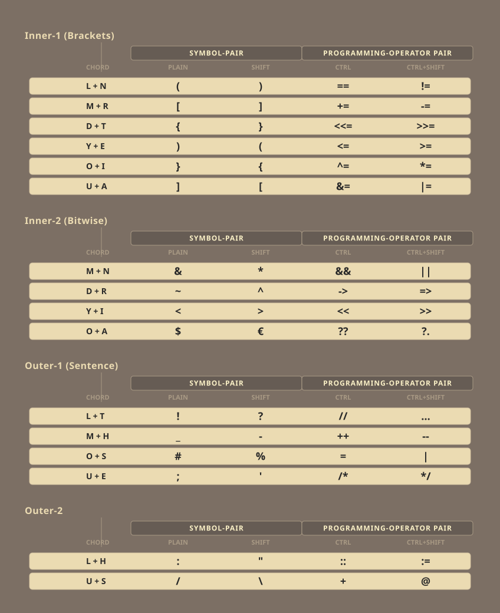

# TwoNr9 ZMK Workspace — What the Fork?!

This repo is significantly improved from the Gemini slop, now MiMo Slop plus good old handywork. Slop will be reduced with time

~~THIS IS GEMINI BASED SLOP THE WHOLE REPO SHOULD/WILL GET IMPROVEMENTS OVER TIME, BETTER ORGANIZATION ETC. IT WORKS AS EXPECTED.~~

[](https://github.com/theharmy/zmk-config/actions/workflows/build-nix.yml) [](https://github.com/theharmy/zmk-config/actions/workflows/test-build-env.yml)

> 📖 **Comprehensive Technical Guide:** See [`config/DOCUMENTATION.md`](config/DOCUMENTATION.md) for full architectural breakdowns, changelogs, hardware targets, and typing guides.
>
> ⚡ **Quick Reference & Visual Infographic:** View [`CHEATSHEET.md`](CHEATSHEET.md) or [`draw/twonr9_cheatsheet.svg`](draw/twonr9_cheatsheet.svg) for an all-in-one visual layout and combo usability reference.
>

---

## Combined Layout Overview

<br /> _(bugwind — generated with [keymap-drawer](https://github.com/caksoylar/keymap-drawer) via `just draw-twonr9`)_

The bugwind diagonal symbol mod-morphs are shown in one overview: normal/Shift outputs
share a panel, followed by separate Ctrl and Ctrl+Shift panels. The symbol chords are
identical on a1 and a2, so each chord appears only once:


Optional **srht** backup variant ([full diagrams](#two-keymap-variants-on-one-shield-definition)):

<br /> _(srht — via `just draw-twonr9 srht`; this is the retained SRHT drawing)_

---

## TwoNr9 Highlights & Benefits

This repository adapts [Urob's ZMK devicetree workspace](https://github.com/urob/zmk-config) for the **TwoNr9 (18-Key Split Keyboard)** running on Zephyr 4.1 and Hardware Model v2 (`nice_nano@2.0.0//zmk`), highly tuned for German typography, programming, and minimal-latency typing:

### 1. Two Keymap Variants on One Shield Definition

The hardware is defined once; the keymap is selected by shield name, so `just build <target>` and CI resolve the right file with no extra flags:

| | **bugwind** (default) | **srht** (backup) |
| --- | --- | --- |
| Shield | `twonr9_left` / `twonr9_right` | `twonr9_srht_left` / `twonr9_srht_right` |
| Keymap | [`config/twonr9.keymap`](config/twonr9.keymap) | [`config/twonr9_srht.keymap`](config/twonr9_srht.keymap) |
| Adaptive keys | none — every letter bound directly | 9 adaptive keys |
| Bigrams (a1) | `RL` `KT` `MB` `YS` `EO` `UI` | `RL` `HN` `DT` `CY` `EO` `UI` |
| Bigrams (a2) | `RW` `MT` `SCH` `GS` `OE` `IU` | `RM` `NB` `KT` `GY` `OE` `IU` |
| ß chord | `S + Space` (+ `ä ö ü` vowels + Space) | `S + R` (6+7) |
| Built by | `build.yaml` (CI) | `build-srht.yaml`, on demand |

```bash
just build all          # bugwind + settings_reset (what CI builds)
just build-srht         # the optional srht backup
just draw-twonr9        # diagrams for bugwind; add `srht` or `all` for both
```

### 2. Dual-Alpha Multiplexing & 12 German Bigrams

- **Base Alphas (`a1`) & Secondary Alphas (`a2`)**: Seamlessly multiplexed across 18 keys.
- **12 Vertical Bigram Macros**: Single-chord typing for the most frequent German digraphs — bugwind `RL` `KT` `MB` `YS` `EO` `UI` / `RW` `MT` `SCH` `GS` `OE` `IU`, srht `RL` `HN` `DT` `CY` `EO` `UI` / `RM` `NB` `KT` `GY` `OE` `IU`.
- **German Eszett & Umlauts**: `ß` is a dedicated chord — `S + Space` on bugwind (the four German letters `ß ä ö ü` are letter + Space on `a1`/`a2`), `S + R` on `6 7` on srht. The `N + R` position on bugwind now yields `´` (shift: backtick via nodeadkeys).

### 3. Complete 14-Pair Mod-Morph Symbol System

Every bracket, quote, slash, and punctuation mark is accessible on the **`sym` layer** without combo clutter:

- `(` / `<` · `)` / `>` · `[` / `{` · `]` / `}`
- `:` / `"` · `;` / `'` · `/` / `\` · `_` / `-`
- `!` / `?` · `#` / `~` · `$` / `€` · `` ` `` / `^` · `&` / `@` · `|` / `=`

### 4. Symmetrical Adaptive Thumb Engine

Both alpha layers share the same four-thumb cluster (outer → inner):

- **Left Outer (14)**: **`SMART_NUM`** — Tap: `num_word` (auto-terminating number entry), Hold: momentary `num` layer.
- **Left Inner (15)**: **`A2_DUAL`** — Tap: one `a2` letter, Hold: continuous `a2` for words like _BMW_, _Quiz_, _Pflanze_. On `a2` itself this thumb toggles back to `a1`.
- **Right Inner (16)**: **`SPC_NAV`** — Tap: `Space` with the sentence-ending `. ` morph, Hold: `nav` layer.
- **Right Outer (17)**: **`SYM_DUAL`** — Tap: one `sym` symbol, Hold: continuous `sym` layer.
- **`MAGIC_SHIFT`** is not on the thumbs — it is reached via the `shiftl` (8+9) and `shiftr` (10+11) combos on every layer, and repeats after any character.

### 5. Right-Hand 3x3 Calculator Numpad

- Natural 3x3 calculator grid on the right hand (`4 5 6` top row, `1 2 3 0` home row, `7 8 9` vertical chords).

### 6. Developer & Tooling Ecosystem

- **ZMK Studio**: Live USB RPC keymap editing on the fly.
- **KeyPeek HID Visualizer**: Real-time layer notification streaming.
- **Helix Editor Integration**: Native `dts-lsp-server` and `clangd` configured in `.helix/languages.toml` via Nix.
- **Custom SVG Visualizer**: Multi-layered, Gruvbox-themed SVG drawings (`just draw-twonr9`).

---

## Credits & Attribution

- **[Urob](https://github.com/urob/zmk-config)**: For the foundational declarative Nix workspace, `zmk-helpers`, `zmk-auto-layer`, `zmk-adaptive-key`, `zmk-tri-state`, and `pin-west`.
- **TwoNr9 Creator**: For the ultra-compact 18-key split hardware design.
- **AI Agent Engineering**: Autonomous design and implementation via Gemini 3.7 Flash.

---

# Original urob/zmk-config Documentation

This is my personal [ZMK firmware](https://github.com/zmkfirmware/zmk/) configuration. At its core is a 34-key base keymap that adapts to boards of various sizes and layouts (currently a Corneish Zen, a Glove80 and a Planck).

The repository doubles as the root of my ZMK workspace: a single manifest file declares the entire firmware — ZMK, Zephyr and every module — and pins it to exact revisions, so the config can track upstream `main` without the risk of silent breakage. Builds run in the cloud as usual, or locally in a nix environment that sets itself up automagically whenever I enter the workspace.

## Highlights

### Toolchain

- [Top-down workspace](#top-down-workspace) bootstrapped from a single declarative manifest
- [Fully locked firmware](#pinning-the-firmware) via [pin-west](https://github.com/urob/pin-west), with automated weekly update PRs
- Self-installing, isolated [local build environment](#building-the-firmware), powered by nix
- [`just` recipes](docs/build-env.md#usage) for building, flashing, and drawing the keymap
- Various developer tools for formatting Devicetree files, testing ZMK modules, etc

### Keymap

- ["Timeless" homerow mods](#timeless-homerow-mods) — homerow mods without timing headaches
- [Combos instead of a symbol layer](#using-combos-instead-of-a-symbol-layer)
- [Numword and smart-mouse](#smart-layers): layers that toggle off automatically
- [Magic thumb](#magic-repeatshiftcapsword) quadrupling as Repeat/Sticky-shift/Shift/Capsword
- [Leader key](#leader-key) sequences for Unicode input and system commands
- [Arrow cluster](#navigation-cluster) doubling as <kbd>home</kbd>, <kbd>end</kbd>, <kbd>begin/end of document</kbd> on long-press
- Shifted actions that make sense: <kbd>, ↦ ;</kbd>, <kbd>. ↦ :</kbd> and <kbd>? ↦ !</kbd>
- Simplified Devicetree syntax using helper macros from [zmk-helpers](https://github.com/urob/zmk-helpers)

If you are looking to adapt this config for your own keyboard, [Part III](#part-iii-adapting-this-config) gives some pointers.

## Part I: The workspace

### Top-down workspace

ZMK's cloud-workflow has always been "top-down": `config/west.yml` declares what goes into the firmware, and `build-user-config` takes it from there. However, the [recommended local setup](https://zmk.dev/docs/development/local-toolchain/setup) inverts this: ZMK itself becomes the root of the workspace, and one adds the config and any other modules on top by hand.

This repo keeps [`config/west.yml`](https://github.com/urob/zmk-config/blob/main/config/west.yml) as the single source of truth for both. The west manifest declares ZMK, Zephyr and every module — each [pinned to an exact revision](#pinning-the-firmware) — and everything else is derived from it: `just init` bootstraps the workspace from the manifest, a self-installing nix environment supplies the entire toolchain, and local and cloud builds stay in sync by construction.

What that buys, concretely:

- **A single repo as the source of truth.** There are no separate ZMK, ZMK config and ZMK module repos to clone and coordinate. The firmware is declared in a single manifest file _in the same repo that configures the keymap_.
- **Nothing to assemble by hand.** Clone the repo and run `just init` to set up a local workspace mirroring the cloud build. `zmk/`, `zephyr/` and `modules/` are generated — delete them and `just init` recreates them exactly.
- **Easy experimentation.** None of this compromises development. Check out a new branch in any module to try out or develop new features, and the next build picks it up automatically.

```
zmk-workspace
├── config/            # keymap files and west.yml
├── draw/              # keymap-drawer config and rendered layouts
├── build.yaml         # build targets
├── flake.nix          # the nix build environment
├── Justfile           # command definitions (`just` without args lists recipes)
│
├── firmware/          # ─── generated by `just build`: compiled firmware ends up here ───
├── modules/           # ─── generated by `just init` ────────────────────────────────────
├── zephyr/
└── zmk/               # ─────────────────────────────────────────────────────────────────
```

[`AGENTS.md`](AGENTS.md) maps out which file to touch for which kind of change.

### Pinning the firmware

Pinning ZMK to a release shields a working config from upstream changes, but the slow release cadence means missing out on new features and fixes for long stretches of time. Tracking `main` has the opposite trade-off: the latest features, but a build that may break from one day to the next.

This repo aims for the best of both worlds using [pin-west](https://github.com/urob/pin-west): every dependency is pinned to an exact commit, making builds reproducible, while the config keeps tracking `main`.

- [`config/west.yml`](https://github.com/urob/zmk-config/blob/main/config/west.yml) records each pin together with the branch it tracks and the date it was taken — including Zephyr, which ZMK's own manifest would otherwise pull by branch.
- `just bump-west` refreshes every pin to the latest revision of its tracked branch, in one command.
- A [scheduled workflow](https://github.com/urob/zmk-config/blob/main/.github/workflows/bump-west.yml) does the same weekly and opens a PR, so updates only land once they build green.

As a bonus, the manifest restricts Zephyr's imports to what ZMK actually needs, avoiding the download of several GBs of unused Zephyr modules. (If you build for less common hardware, you may need to extend the allowlist.)

### Building the firmware

**In the cloud.** Push your changes and download the firmware from the repository's `Actions` tab as usual — no local setup required. (GitHub disables Actions on newly created forks; enable them once from the fork's `Actions` tab before the first push.) The build runs on the same nix environment as the local setup, which keeps both in lockstep and avoids maintaining a second toolchain definition. The stock ZMK workflow is kept around for reference and remains available via manual dispatch.

**Locally.** For faster iteration, the repo ships a nix-powered build environment that sets itself up automagically when you enter the workspace and stays _completely isolated_ from the rest of your system. Once a few prerequisites are in place, the entire setup is:

```bash
cd zmk-workspace
direnv allow   # sets up the build environment
just init      # bootstraps the workspace from config/west.yml
```

After this initial setup, entering the workspace automatically activates the build environment. From there, `just build all` compiles every target in `build.yaml`, `just flash <target>` flashes non-UF2 boards, and `just draw` re-renders the keymap images. Running `just` without arguments prints the complete list of available recipes.

See [`docs/build-env.md`](docs/build-env.md) for a setup guide and a detailed recipe reference. The environment itself is [continuously tested](https://github.com/urob/zmk-config/actions/workflows/test-build-env.yml) on Linux and macOS.

### Timeless homerow mods

[Homerow mods](https://precondition.github.io/home-row-mods) (aka "HRMs") can be a game changer — at least in theory. In practice, they require some finicky timing: In its most naive implementation, in order to produce a "mod", they must be held _longer_ than `tapping-term-ms`. In order to produce a "tap", they must be held _less_ than `tapping-term-ms`. This requires very consistent typing speeds that, alas, I do not possess. Hence my quest for a "timer-less" HRM setup.

After months of tweaking, I eventually ended up with an HRM setup that is essentially timer-less, resulting in virtually no misfires.[^1] Yet it provides a fluent typing experience with mostly no delays.

One way to make HRMs effectively timer-less is to set `tapping-term-ms` to an extremely large value, say 5 seconds. This removes the need for quick timing decisions, but it introduces two issues: (1) To trigger a mod, you'd need to hold the HRM keys for what feels like an eternity. (2) During normal typing, there's a noticeable delay between pressing a key and seeing it appear on the screen.[^2] To address these, I use positive and negative exceptions that short-circuit the tapping term in most scenarios.

- Specifically, to address the activation delay, I use ZMK's `balanced` flavor, which produces a "hold" if another key is both pressed and released within the tapping-term. Because that's exactly what I normally do with HRMs, there's virtually never a need to wait past my long tapping term (see below for two exceptions).
- To address the typing delay, I use ZMK's `require-prior-idle-ms` property, which immediately resolves an HRM as a "tap" when it's pressed shortly _after_ another key has been tapped. This all but completely eliminates the delay.

This is great but there are still a few rough edges:

- When rolling keys, I sometimes unintentionally end up with "nested" key sequences: `key1` down, `key2` down and up, `key1` up. Because of the `balanced` flavor, this would falsely register `key1` as a mod. As a remedy, I use ZMK's "positional hold-tap" feature to force HRMs to always resolve as "tap" when the _next_ key is on the same side of the keyboard. Problem solved.
- ... or at least almost. By default, positional-hold-tap performs the positional check when the next key is _pressed_. This is not ideal, because it prevents combining multiple modifiers on the same hand. To fix this, I use the `hold-trigger-on-release` setting, which delays the positional-hold-tap decision until the next key's _release_. With this, mods can be combined when held while positional hold-tap continues to work as expected when keys are tapped.
- So far, nothing of the configuration depends on the duration of `tapping-term-ms`. In practice, there are two reasons why I don't set it to infinity:
    1. Sometimes, in rare circumstances, I want to combine a mod with an alpha-key _on the same hand_ (e.g., when using the mouse with the other hand). My positional hold-tap configuration prevents this _within_ the tapping term. By setting the tapping term to something large but not crazy large (I use 280ms), I can still use same-hand `mod` + `alpha` shortcuts by holding the mod for just a little while before tapping the alpha-key.
    2. Sometimes, I want to press a modifier without another key (e.g., on Windows, tapping `Win` opens the search menu). Because the `balanced` flavor only kicks in when another key is pressed, this also requires waiting past `tapping-term-ms`.
- Finally, it is worth noting that this setup works best in combination with a dedicated shift for capitalization during normal typing (I like sticky-shift on a home-thumb). This is because shifting alphas is the one scenario where pressing a mod may conflict with `require-prior-idle-ms`, which may result in false negatives for fast typers.

Here's my configuration — aside from the [zmk-helpers](https://github.com/urob/zmk-helpers) syntax sugar, it works with plain upstream ZMK.

```C++
#include "zmk-helpers/key-labels/36.h"                                      // Source key-labels.
#define KEYS_L LT0 LT1 LT2 LT3 LT4 LM0 LM1 LM2 LM3 LM4 LB0 LB1 LB2 LB3 LB4  // Left-hand keys.
#define KEYS_R RT0 RT1 RT2 RT3 RT4 RM0 RM1 RM2 RM3 RM4 RB0 RB1 RB2 RB3 RB4  // Right-hand keys.
#define THUMBS LH2 LH1 LH0 RH0 RH1 RH2                                      // Thumb keys.

/* Left-hand HRMs. */
ZMK_HOLD_TAP(hml,
    flavor = "balanced";
    tapping-term-ms = <280>;
    quick-tap-ms = <175>;
    require-prior-idle-ms = <150>;
    bindings = <&kp>, <&kp>;
    hold-trigger-key-positions = <KEYS_R THUMBS>;
    hold-trigger-on-release;
)

/* Right-hand HRMs. */
ZMK_HOLD_TAP(hmr,
    flavor = "balanced";
    tapping-term-ms = <280>;
    quick-tap-ms = <175>;
    require-prior-idle-ms = <150>;
    bindings = <&kp>, <&kp>;
    hold-trigger-key-positions = <KEYS_L THUMBS>;
    hold-trigger-on-release;
)
```

#### Troubleshooting

- **Noticeable delay when tapping HRMs:** Increase `require-prior-idle-ms`. As a rule of thumb, you want to set it to at least `10500/x` where `x` is your (relaxed) WPM for English prose.[^3]
- **False negatives (same-hand):** Reduce `tapping-term-ms` (or disable `hold-trigger-key-positions`)
- **False negatives (cross-hand):** Reduce `require-prior-idle-ms` (or set flavor to `hold-preferred` — to continue using `hold-trigger-on-release`, you must apply this [patch](https://github.com/celejewski/zmk/commit/d7a8482712d87963e59b74238667346221199293) to ZMK)
- **False positives (same-hand):** Increase `tapping-term-ms`
- **False positives (cross-hand):** Increase `require-prior-idle-ms` (or set flavor to `tap-preferred`, which requires holding HRMs past tapping term to activate)

## Related resources

- The official [ZMK documentation](https://zmk.dev/docs) — the reference for everything upstream: behaviors, keycodes, configuration and the build system.
- The [collection](https://github.com/search?q=topic%3Azmk-module+fork%3Atrue+owner%3Aurob+&type=repositories) of ZMK modules used in this configuration.
- [pin-west](https://github.com/urob/pin-west), the manifest-locking tool used to [pin the firmware](#pinning-the-firmware). It works with any west workspace, not just this one.

[^1]: I call it "timer-less", because the large tapping-term makes the behavior insensitive to the precise timings. One may say that there is still the `require-prior-idle` timeout. However, with both a large tapping-term and positional-hold-taps, the behavior is _not_ actually sensitive to the `require-prior-idle` timing: All it does is reduce the delay in typing.

[^2]: The delay is determined by how quickly a key is released and is not directly related to the tapping-term. But regardless of its duration, most people still find it noticeable and disruptive.

[^3]: E.g, if your WPM is 70 or larger, then the default of 150ms (=10500/70) should work well. The rule of thumb is based on an average character length of 4.7 for English words. Taking into account 1 extra tap for `space`, this yields a minimum `require-prior-idle-ms` of (60 \* 1000) / (5.7 \* x) ≈ 10500 / x milliseconds. The approximation errs on the safe side, as in practice home row taps tend to be faster than average.
