# TwoNr9 ZMK Configuration

[](https://github.com/theharmy/zmk-config/actions/workflows/build-nix.yml) [](https://github.com/theharmy/zmk-config/actions/workflows/test-build-env.yml)

> 📖 **Technical guide:** See [`config/DOCUMENTATION.md`](config/DOCUMENTATION.md) for architecture, file ownership, hardware, and build details.
>

## Layout

<br />
_Every layer, drawn from `draw/twonr9_srht.yaml` with keymap-drawer (`just keymap-svg`)._

**[Interactive map](draw/twonr9_keymap.html)** — layer tabs, all eight chord states, and every
chord with the keys it needs (`just keymap-html`).

## The keymap

One keymap, [`config/twonr9.keymap`](config/twonr9.keymap), built by the `twonr9_left` /
`twonr9_right` shields. The `_srht` suffixes on `twonr9_combos_srht.dtsi`,
`twonr9_macros_srht.dtsi` and `twonr9_adaptive_keys_srht.h` name the layout family; there is no
second variant.

A second physical build of the same board — **smol2nr9** (`smol2nr9_left` / `smol2nr9_right`) — is
wired to different pins but is otherwise identical. It reuses the same keymap and hardware settings
through `config/smol2nr9.keymap` (which includes `twonr9.keymap`) and `config/smol2nr9.conf`; only
`config/boards/shields/smol2nr9/` differs.

Flash **`firmware/twonr9_left_with_snippets.uf2`** on the left half: it is the build with the
`layer-hud-usb-uart` snippet, without which the HUD gets no layer signal over USB. The same applies
to `firmware/smol2nr9_left_with_snippets.uf2`.

```bash
just build all      # both boards, their HUD variants, right halves, settings_reset
just build smol     # only the smol2nr9 targets
just keymap-html    # the interactive page
just keymap-svg     # every layer as an SVG
```

For the current layers, combos, symbol chords, and typing workflow, use the
[cheatsheet](docs/CHEATSHEET.md). The architecture and file-by-file maintenance
guide is in [`AGENTS.md`](AGENTS.md).

## Workspace and local development

This repository is a [ZMK](https://github.com/zmkfirmware/zmk/) workspace. `config/west.yml` declares ZMK, Zephyr, and modules at pinned revisions. Builds run in GitHub Actions or locally in the Nix environment.

See [`docs/build-env.md`](docs/build-env.md) for local setup and recipe details. The environment is
[tested on Linux and macOS](.github/workflows/test-build-env.yml); cloud builds need no local setup.

## Related resources

- [ZMK documentation](https://zmk.dev/docs)
- [Urob's ZMK config](https://github.com/urob/zmk-config) and [module collection](https://github.com/search?q=topic%3Azmk-module+fork%3Atrue+owner%3Aurob+&type=repositories)
- [pin-west](https://github.com/urob/pin-west)
