# TwoNr9 ZMK Configuration

[](https://github.com/theharmy/zmk-config/actions/workflows/build-nix.yml) [](https://github.com/theharmy/zmk-config/actions/workflows/test-build-env.yml)

> 📖 **Technical guide:** See [`config/DOCUMENTATION.md`](config/DOCUMENTATION.md) for architecture, file ownership, hardware, and build details.
>

## Layouts

<br /> _(bugwind — generated with [keymap-drawer](https://github.com/caksoylar/keymap-drawer) via `just draw-twonr9`)_

Optional **srht** backup variant ([full diagram](./draw/twonr9_srht_combined_overview.svg)):



---

## Variants and builds

The physical keyboard is defined once; shield names select the keymap.

| | **bugwind** (default) | **srht** (backup) |
| --- | --- | --- |
| Shield | `twonr9_left` / `twonr9_right` | `twonr9_srht_left` / `twonr9_srht_right` |
| Keymap | [`config/twonr9.keymap`](config/twonr9.keymap) | [`config/twonr9_srht.keymap`](config/twonr9_srht.keymap) |
| Adaptive keys | 2 (`u oi`, `y us`) — every letter otherwise bound directly | 9 adaptive keys |
| Bigrams (a1) | `RL` `KT` `MB` `YS` `EO` `UI` | `RL` `HN` `DT` `CY` `EO` `UI` |
| Bigrams (a2) | `RW` `MT` `SCH` `GS` `OE` `IU` | `RM` `NB` `KT` `GY` `OE` `IU` |
| ß chord | `S + Space` (10+16) (+ `ä ö ü` vowels + Space) | `C + Space` (10+16, same positions — shared via `symbol_work.dtsi`) |
| Build | `build.yaml` (CI) | `build-srht.yaml`, on demand |

```bash
just build all          # bugwind + settings_reset (what CI builds)
just build-srht         # the optional srht backup
just draw-twonr9        # diagrams for bugwind; add `srht` or `all` for both
just draw-check all     # fail if generated drawings are stale; never edits files
```

For the current layers, combos, symbol chords, and typing workflow, use the
[cheatsheet](docs/CHEATSHEET.md). The architecture and file-by-file maintenance
guide is in [`AGENTS.md`](AGENTS.md).

## Workspace and local development

This repository is a [ZMK](https://github.com/zmkfirmware/zmk/) workspace. `config/west.yml` declares ZMK, Zephyr, and modules at pinned revisions. Builds run in GitHub Actions or locally in the Nix environment.

See [`docs/build-env.md`](docs/build-env.md) for local setup and recipe details. The environment is
[tested on Linux and macOS](.github/workflows/test-build-env.yml); cloud builds need no local setup.

## Related resources

- [ZMK documentation](https://zmk.dev/docs)
- [Urob's ZMK config](https://github.com/urob/zmk-config) and [module collection](https://github.com/search?q=topic%3Azmk-module+fork%3Atrue+owner%3Aurob+&type=repositories)
- [pin-west](https://github.com/urob/pin-west)
